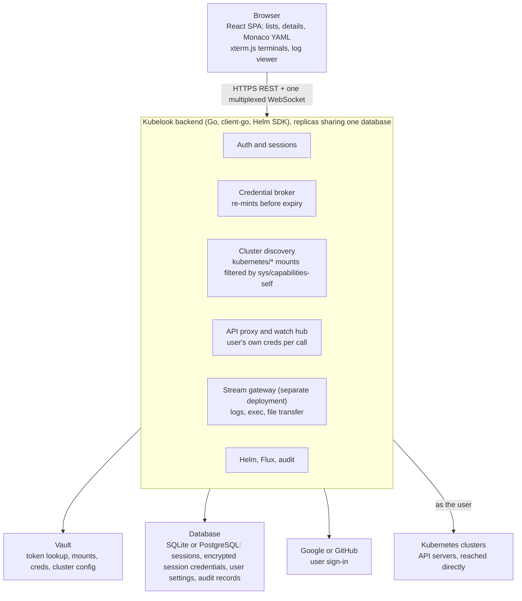

# Kubelook — Product & Technical Spec

Last updated: 2026-11-10

## Overview

Kubelook is a browser-based Kubernetes console. Users sign in with Google or GitHub, then add a Vault token or an uploaded kubeconfig, and get full day-2 operations on every cluster that credential reaches, with no desktop install.

**Problem.** Engineers need to investigate and operate many Kubernetes clusters, and cluster access is brokered through Vault. They need one place in the browser where a Vault token, or a kubeconfig, opens exactly the clusters they are allowed to see. They shouldn't need a kubeconfig or cluster credentials set up on their machines: a Vault token they already have, or an uploaded kubeconfig, is enough.

**Goals**

- Sign-in with a Google or GitHub account, which identifies the user and keeps their settings. Then two ways to reach clusters: a Vault token, or a kubeconfig file.
- A Vault token loads every cluster the token's policies can get credentials for. A kubeconfig loads every context in the file.
- Day-2 operations in the browser: logs, container shells, live manifest editing, Helm releases, FluxCD objects, CRDs, and status and editing for all core workload, storage and networking objects.
- Troubleshooting tools: a debug toolkit, a pod file browser and a live resource map.
- Ecosystem modules for Karpenter, KEDA, External Secrets, Vault Secrets Operator, cert-manager, the Gateway API and security reports. Each module appears only on clusters that have the matching CRDs.
- Everything runs under the user's own Kubernetes identity, so cluster RBAC stays the only authority on what they can do.
- Vault stays the single place where access is defined. The console reads from Vault but never creates or changes its policies, roles or secrets engines; Vault admins keep owning those.
- No user management or authorization inside the console. Vault decides who can reach which cluster, and cluster RBAC decides what they can do there. The console has no admin role or permission settings; operators configure it through its deployment settings, and the settings page holds only app settings and user preferences. It keeps a record per signed-in account only to store that user's settings.

**Non-goals for v1**

- A plugin marketplace. The architecture leaves room for plugins, but v1 ships the features above as built-ins.
- Port-forwarding, and any feature that needs a TCP tunnel from the user's machine to a pod or service. This rules out local port forwards, database and message-broker clients (for example PostgreSQL, Kafka or RabbitMQ consoles) and anything else that reaches a workload through a forwarded port. The console only uses the Kubernetes API, including the `exec` subresource.
- An AI assistant. It is a possible future feature and is not designed here.

**Target users**

- Application engineers who need logs, shells and restarts.
- Platform and SRE engineers who manage Helm, Flux and cluster-wide objects across many clusters.
- On-call responders who need fast access from any machine without setting up a kubeconfig.

## Authentication and cluster discovery

Sign-in has two steps. First the user signs in with Google or GitHub, which says who they are. Then they add a Vault token (Path A) or a kubeconfig (Path B), which says which clusters they can reach. Both paths end in the same state: a server-side session that holds short-lived Kubernetes credentials per cluster. The browser gets a session cookie and, for saved credentials, only encrypted copies it can't read.

### Step 1: Google or GitHub sign-in

1. The user picks Google or GitHub and signs in through that provider's OAuth 2.0 / OpenID Connect flow, with the authorization code flow and PKCE.
2. Whoever deploys the console chooses who may sign in with `auth.restrictSignIn`. When it is `true` (the default), the account must match an allowlist: for Google, the ID token's email must be verified and its hosted domain (`hd` claim) must be in `auth.google.allowedDomains`; for GitHub, the user must be a member of an organization in `auth.github.allowedOrgs`, which needs the `read:org` scope. If the organization has OAuth app access restrictions turned on (GitHub turns them on by default for new organizations), an organization owner must approve Kubelook's OAuth app first, or the membership check can't see the organization ([GitHub docs](https://docs.github.com/en/organizations/managing-oauth-access-to-your-organizations-data/about-oauth-app-access-restrictions)). Sign-in is refused when the account doesn't match, or when no list is set. When it is `false`, any Google or GitHub account can sign in, and the Vault token or kubeconfig alone decides which clusters it reaches.
3. The account becomes the user's identity in the console: a user record keyed by provider and the provider's stable account ID (Google `sub`, GitHub numeric user ID), not by email.
4. The console never uses the Google or GitHub token to reach clusters or Vault. It is used only to sign in and to check domain or organization membership.

| Setting | Default | Purpose |
| --- | --- | --- |
| `auth.restrictSignIn` | `true` | `true` allows only accounts in the domain and organization lists below; `false` allows any Google or GitHub account |
| `auth.google.clientId`, `auth.google.clientSecretRef` | none | OAuth client for Google sign-in; Google is offered only when set |
| `auth.google.allowedDomains` | none | Google Workspace domains allowed to sign in |
| `auth.github.clientId`, `auth.github.clientSecretRef` | none | OAuth app for GitHub sign-in; GitHub is offered only when set |
| `auth.github.allowedOrgs` | none | GitHub organizations whose members may sign in |

### Path A: Vault token

Each cluster has its own Kubernetes secrets engine mount at `kubernetes/<cluster-name>/`. The mount holds everything needed to build a client: `GET kubernetes/<cluster>/config` returns the API server URL (`kubernetes_host`) and CA (`kubernetes_ca_cert`), and `POST kubernetes/<cluster>/creds/<role>` mints a short-lived service account token. So there is no separate cluster registry: the mounts *are* the registry. Vault returns only the `kubernetes_host` and `kubernetes_ca_cert` values the Vault admin set on the mount. A mount that relies on Vault's in-cluster defaults returns them empty, and Kubelook can't open that cluster (see Opening a cluster).

**Discovery (at sign-in)**

1. The user pastes a Vault token. The backend validates it with `auth/token/lookup-self`, records its TTL and policies, and gives the browser an encrypted copy to keep (see Storage under Sessions), so it is still there at the next sign-in in that browser until it expires or the user removes it. An expired token is dropped and the user is asked for a new one.
2. The backend calls `GET sys/internal/ui/mounts` with the user's token and keeps the mounts of type `kubernetes` under the configured prefix (default `kubernetes/`). This needs no `sys/mounts` permission: with a token, the response includes every mount the token has path capabilities on, which covers each cluster the user can read config or mint creds for. It lists only mounts in the Vault namespace the request is made in, so mounts in a child namespace are not found; Kubelook has no Vault namespace setting yet (see Open questions). Vault documents it as [an internal endpoint with no backwards-compatibility guarantee](https://developer.hashicorp.com/vault/api-docs/system/internal-ui-mounts), so every Vault upgrade must be tested against it before rollout.
3. For each mount, the backend checks the configured candidate roles with `POST sys/capabilities-self` on `kubernetes/<cluster>/creds/<role>` and `kubernetes/<cluster>/config` ([Vault API](https://developer.hashicorp.com/vault/api-docs/system/capabilities-self)). The endpoint takes a list of paths, so the paths of many mounts go in one call.
4. A cluster appears in the sidebar if the token can `read` its config and `update` at least one role's creds path. `create` alone is not enough: the creds path handles only the update operation and has no existence check, so Vault treats every write to it as an update. If more than one role is allowed, the user picks one when opening the cluster; the first allowed role in the configured order is the default.

**Opening a cluster**

1. `GET kubernetes/<cluster>/config` gives the API server URL and CA. Kubelook uses them as Vault returns them. If either comes back empty, opening the cluster fails with a message that says the mount's config has no API server address or CA. Making sure each mount's `kubernetes_host` and `kubernetes_ca_cert` are set to an address and CA Kubelook can reach is the deployer's responsibility; Kubelook has no per-cluster override.
2. `POST kubernetes/<cluster>/creds/<role>` with `kubernetes_namespace` and `cluster_role_binding` from the Helm values returns `service_account_name` and `service_account_token` ([Vault API](https://developer.hashicorp.com/vault/api-docs/v1.16.x/secret/kubernetes)). `cluster_role_binding=true` requires the Vault role to use `kubernetes_role_type=ClusterRole`; with a `Role`-type Vault role, Vault answers "a ClusterRoleBinding cannot ref a Role". `kubernetes_namespace` must be one the Vault role allows (`allowed_kubernetes_namespaces` or its selector), or Vault refuses the request. Both settings are global today, so every role on every cluster must fit them (see Open questions).
3. The backend builds an in-memory client config from the URL, CA and token. Nothing is written to disk.
4. Vault's sample response for these credentials shows `renewable: false`, so the backend mints a fresh token shortly before the current one expires rather than renewing it. On logout or session expiry it deletes the session's credentials from the database, including the minted cluster credentials, and closes every open watch, log stream and shell for that session, because those connections stay authenticated after the session ends. It does not revoke the lease: the credentials stay valid until their TTL runs out, and Vault then removes the service account objects it created. Four details follow from how Vault works:
   - Vault creates objects only for roles that use `kubernetes_role_name` or `generated_role_rules`. A role that uses `service_account_name` gets a token for an existing service account, nothing is created or removed, and the token simply runs to its TTL.
   - If no `ttl` is sent, Vault uses the role's `token_default_ttl`, and if the role has none, the mount's or Vault's default lease TTL. `vault.tokenTTL` is unset by default, so the lifetime of a signed-out user's credentials depends on each role (see Open questions).
   - Vault revokes a token's leases when the token expires or is revoked ([Vault leases](https://developer.hashicorp.com/vault/docs/concepts/lease)). So when the user's Vault token ends, the cluster credentials minted with it end too, even if their own TTL has time left.
   - Revoking on logout would need `update` on `sys/leases/revoke`, which Vault's `default` policy does not grant.

**When Vault is unreachable**

- Clusters that are already open keep working until their current Kubernetes credentials expire, because those credentials were minted before the outage. They can't be re-minted until Vault is back.
- Opening a new Vault cluster fails with a clear message ("Vault is unreachable, so this cluster can't be opened right now"). The console can't open it without Vault, because the Kubernetes credentials come from `kubernetes/<cluster>/creds/<role>`.
- Kubeconfig clusters keep working, since they don't use Vault.
- A banner says Vault is unreachable. The console retries in the background, and when Vault answers again it removes the banner and lets the user open clusters again.

**Helm chart settings for Vault**

| Setting | Default | Purpose |
| --- | --- | --- |
| `vault.address` | none | Vault URL |
| `vault.kubernetesMountPrefix` | `kubernetes/` | Where cluster mounts live |
| `vault.credsNamespace` | `itops` | `kubernetes_namespace` sent when minting tokens, where Vault creates the temporary service account |
| `vault.clusterRoleBinding` | `true` | `cluster_role_binding` sent when minting tokens |
| `vault.candidateRoles` | none | Roles to check per cluster, in order of preference (for example `devops-role`, `platform-hub-role`) |
| `vault.tokenTTL` | unset (role default) | Optional `ttl` sent when minting tokens |
| `vault.expiryWarning` | `30m` (proposed) | Time left on a saved Vault token at which the console starts warning the user |

### Path B: kubeconfig upload

1. The user uploads or pastes a kubeconfig. It is parsed server-side, and the browser keeps an encrypted copy until the user removes it (see Storage under Sessions), so its clusters are there at the next sign-in in that browser.
2. Every context becomes a cluster in the sidebar, named `<file label>/<context>`.
3. Supported auth: embedded client certificates, bearer tokens, and OIDC `auth-provider` refresh tokens. For OIDC, the backend contacts the `idp-issuer-url` named in the kubeconfig to refresh the token, so that URL is a second user-supplied address besides the server URL. When the issuer returns a new refresh token, the backend gives the browser a fresh encrypted copy of the kubeconfig, because the saved one no longer works.
4. Rejected with a clear message: file-path references (`client-certificate`, `certificate-authority` and the OIDC `idp-certificate-authority` by path), and any user entry that uses an `exec` credential plugin. The console never runs commands from a kubeconfig; `exec` plugins are not supported. This rules out the kubeconfigs that EKS and GKE generate, and the ones AKS generates for clusters that use Microsoft Entra ID, because they use `exec` plugins and would also need cloud credentials on the server. (AKS clusters without Entra ID hand out certificate-based kubeconfigs, which work.) Those clusters are reached through Vault, or through a kubeconfig with an embedded token, such as one built from a Vault-minted service account token.
5. The console does not filter server URLs itself. It connects to whatever address a kubeconfig names, so whoever deploys it must restrict its outbound traffic with a firewall or network policy, for example to the cluster API servers, Vault, the database, Google or GitHub, the OIDC issuers of uploaded kubeconfigs, and the Helm repositories and OCI registries users may install from. A plain Kubernetes NetworkPolicy filters by IP address and port, not by host name. An allowlist that leaves out Helm sources disables installing charts from them.

### Sessions

- **Cookie:** an HttpOnly, Secure, SameSite=Lax cookie holds an opaque session ID. Mutating requests carry a CSRF token.
- **Storage:** sessions, active-session credentials and user settings live in a relational database: SQLite for a single-replica deployment, PostgreSQL for more than one replica.
- **Saved credentials stay in the browser:** the user's Vault token and uploaded kubeconfigs are not stored in the database. The server encrypts each one and the browser keeps only that encrypted copy (in IndexedDB), which page scripts can read but can't decrypt. Each copy is bound to the user record that saved it: the user's ID is part of the authenticated data of the encryption, so the server refuses to decrypt a copy in any other account's session. At sign-in the browser sends the copies back, and the server decrypts them into the session. A database leak alone therefore exposes no saved credentials of signed-out users; an attacker needs a browser's copy and either the server's key or a session signed in as that same user. While a user is signed in, their decrypted credentials are in the database as session credentials (see below). Saved credentials stay in the browser that saved them, so on another machine, or after the user clears site data, they paste them again. Safari also removes script-writable storage, IndexedDB included, after 7 days of browser use without interaction with the site ([WebKit](https://webkit.org/tracking-prevention/)), so Safari users who stay away that long paste them again too. The user can see and remove them from the settings page. Removing a copy deletes it from that browser only; a copy that was taken elsewhere stays decryptable until the key changes (see Open questions).
- **Encryption key:** all encryption uses one key, which the app reads from the `KUBELOOK_ENCRYPTION_KEY` environment variable (proposed name). How that variable is set, and where the key comes from, is up to whoever deploys the console. The Helm chart sets it from a Kubernetes Secret named in `encryption.keySecret`.
- **Changing the key:** the console holds one key at a time; there are no old keys and no re-encryption. Every encrypted value is AES-256-GCM with a random nonce and records the ID of the key that encrypted it. To rotate, whoever deploys the console sets a new key in `KUBELOOK_ENCRYPTION_KEY` and restarts the console. All replicas and the stream gateway must be restarted together: while old-key and new-key replicas run side by side, each discards what the other encrypted. From then on:
  - Encrypted copies that a browser sends with an unknown key ID are discarded, and the user sees: "Kubelook's encryption key was changed, so your saved Vault token and kubeconfigs can't be used anymore. Please paste your token and upload your kubeconfigs again."
  - Active-session credentials in the database become unreadable too, so every signed-in user is signed out and sees the same message at their next sign-in.
  - Users are never left with credentials that fail silently. The change is recorded in the audit log by key ID, never the key itself. If the key leaked, replacing it stops Kubelook from accepting anything encrypted with the old key, but it is not the whole response. Whoever held the key together with a database copy or a browser's copies may already have the plaintext credentials, and those work directly against Vault and the clusters until they expire or are revoked. The response therefore also includes revoking the affected Vault tokens and rotating the credentials in uploaded kubeconfigs. With one key and random 96-bit nonces, NIST SP 800-38D limits a key to 2^32 encryptions; Kubelook's volume is expected to stay far below that, and the load test confirms the rate.
- **Session credentials:** while a session is active, its decrypted Vault token, kubeconfig credentials and the Kubernetes credentials minted from Vault are held in the database, encrypted, so any replica can serve the session. They are deleted when the session ends.
- **User settings:** favourite clusters, saved filter sets, column presets and namespace filters stay with the user record across sessions and machines.
- **Vault token renewal:** the console never renews a Vault token on its own. The user renews it with a **Renew** button, which calls `auth/token/renew-self`. Each renewal extends the token's TTL, but never past its maximum TTL as set in the user's Vault. Vault can't report that limit in advance in the usual case, because it works out the maximum at each renewal ([Vault token TTLs](https://developer.hashicorp.com/vault/docs/concepts/tokens)), so the console learns it has been reached when a renewal no longer extends the TTL. An expired token can't be renewed: Vault revokes it when its TTL runs out. Batch tokens can't be renewed at all, so for them the banner never shows the button. A token whose TTL is 0 never expires and gets no expiry warning.
- **Cluster credential renewal:** while a session is active, the backend re-mints each open cluster's Kubernetes token shortly before it expires.
- **Expiry warnings:** when a saved Vault token has less than `vault.expiryWarning` left, the console shows a banner on every page with the time left and the **Renew** button. If the token isn't renewable, or a renewal no longer extends its TTL, the banner drops the button and tells the user to get a new token from Vault (for example by logging in to Vault again) and paste it into their Kubelook settings. The settings page has a box to paste the new token without closing open terminals, log streams or editors.
- **After expiry:** once the token has expired, the banner says so, its Vault clusters show as disconnected in the cluster rail, and the user sees the same instructions at every sign-in until they paste a new token or remove the old one.
- **Idle sessions:** a session ends after an idle timeout (proposed 30 min with no interaction and no open stream), which stops cluster credential re-minting and closes its connections.
- **Sources:** a user can hold a Vault token and uploaded kubeconfigs at the same time. The sidebar groups clusters by source.

## Architecture

A Go backend sits between the browser and every cluster. Its replicas share one database for sessions, settings and audit records, so any replica can serve any request; the only state a replica holds itself is its open connections (watches, log streams, shells), the objects cached for those watches, and its queue of Helm jobs, which is why WebSockets are sticky. It holds credentials, proxies API calls under the user's identity, and multiplexes watches and streams over one WebSocket per browser tab.

The browser talks only to the backend. The backend talks to Google or GitHub to sign the user in, to Vault for cluster credentials, to the database for sessions, encrypted session credentials, user settings, jobs and audit records, and to each cluster's API server as the user.

- **Backend language: Go.** client-go, the Helm 3 SDK and the Flux APIs are all Go.
- **Frontend:** React and TypeScript, Monaco for YAML, xterm.js for shells.
- **Watch hub:** one upstream watch per user, cluster, kind and namespace, fanned out to every open view. It's closed after an idle timeout. A watch that drops while its view is still open (a network blip, or a move to another replica) is resumed from the last `resourceVersion`; if the API server answers `410 Gone` because that version is too old, the backend lists again and starts a new watch. The browser reports when a tab is hidden (the Page Visibility API), and a watch that only hidden tabs or closed views use is closed once the idle timeout passes. The timeout is 30 seconds by default and is an app setting, changed on the settings page, not a deployment setting. When the user returns to the view, the list reloads and goes live again.
- **One WebSocket per tab** carries watch events, log lines, exec frames and file-transfer chunks as tagged channels, with a heartbeat.
- **Network placement:** the console runs inside the same network as the clusters and connects to each API server directly. There is no agent or tunnel: a cluster the console's network can't reach stays out of reach, so a private cluster stays private.
- **Deployment:** one image and a Helm chart. The supported deployment is the Helm chart on Kubernetes. The app itself is configured only through environment variables and a YAML file, so it doesn't depend on Kubernetes: the docs also give plain `docker run` commands for the console, the stream gateway and the audit cleanup, which someone could use on a single machine such as an EC2 instance. That route is documented but not a supported deployment. A single replica can use SQLite on a persistent volume. Two or more replicas run behind a load balancer with sticky WebSockets and share a PostgreSQL database, which should be highly available.

### Replica restarts and failures

- **Sessions and credentials** are in the database, so when a replica stops, the browser reconnects to another one and the user stays signed in. Vault and kubeconfig clusters reopen from the session's stored credentials; nothing is pasted or uploaded again.
- **Watches** reopen on the new replica. The new replica has no cached objects, so it lists each open view again and then watches; lists pause briefly and catch up. When a replica with many sessions stops, all of its users' views list again at once. **Log streams** restart from the last line's timestamp; a few lines around the gap may repeat or be missing.
- **Shells** can't survive the connection that carries them, so a shell on a stopped replica ends, along with anything running in it. The terminal shows an error explaining that the server connection was lost and the shell session ended, and offers to start a new shell. **File transfers** in progress fail with a similar message and must be started again.
- **Stream gateway:** shells, log streams and file transfers run in a separate stream gateway deployment from the same image, which changes rarely, so the main backend can be redeployed without ending anyone's shell.
- **Planned restarts drain:** before a replica or gateway stops, it stops accepting new shells and waits up to `streams.drainTimeout` (proposed 30 min) for open ones to finish, with a banner asking users to finish their shell sessions. Only shells still open at the deadline are ended, with the error above.
- **Long actions are durable jobs.** Helm installs, upgrades, rollbacks and uninstalls, node drains and bulk actions are written to the database before they start: who started them, the cluster and objects, the target state (for Helm: chart, version, values hash and the starting revision), status and progress. The replica running a job renews a short lease on it. If the lease expires because the replica died, another replica checks the cluster against the target state:
  - Helm release deployed at the target: the job is marked succeeded.
  - Helm release unchanged from the starting revision, or a drain or bulk action part-way through: the job is marked interrupted.
  - Helm release stuck in a `pending-*` state: the job is marked interrupted, with rollback to the starting revision offered. A first install stuck in `pending-install` has no earlier revision, so uninstall is offered instead.

  An interrupted job is never retried automatically. The user sees what happened and what is left, and clicks Retry (or Roll back); the retry runs under their current credentials and is audited like any other action. Users can see their jobs' progress from any tab or after reconnecting.

### Replica memory

Memory grows with what users have open, so each part has a bound, and the replica as a whole has a ceiling.

- **Watches:** the 30-second idle and hidden-tab close keeps each user to the views they are actually looking at. Before an object is kept in memory, the backend drops fields the UI never shows, notably `metadata.managedFields`, which keeps large lists (such as all pods on a big cluster) small. There is no separate per-user watch cap.
- **Log streams:** each stream has a small fixed server-side buffer. If a browser can't keep up, the oldest buffered lines are dropped instead of queued without limit, on top of the per-stream rate cap. File transfers are streamed in chunks and never held whole.
- **Helm jobs:** each replica runs at most `helm.maxConcurrentJobs` (proposed 5) Helm jobs at once and queues the rest, and refuses charts larger than `helm.maxChartBytes` (proposed 10 MiB).
- **Replica ceiling:** the pod has a Kubernetes memory limit, and Go's `GOMEMLIMIT` is set just below it so garbage collection works harder before the limit. Above `memory.refuseNewWorkPercent` (proposed 80%) of the limit, the replica refuses new watches, shells and Helm jobs with a clear "server busy, try again shortly" message instead of running out of memory and dropping everyone's connections. Existing connections keep working.
- **Measuring:** memory per watch, watches per user, stream buffer sizes and refused requests are exported as Prometheus metrics. The proposed numbers above are set for real from the load test.

## Functional requirements

Every list and detail view of cluster objects is backed by a live watch, so status changes appear without a refresh. Two things can't be watched and are polled instead: metrics (metrics-server serves get and list only) and Helm releases (a release is not a cluster object). Every action is checked against the user's own RBAC before it's shown.

### Resource coverage

| Area | Kinds | Views | Actions |
| --- | --- | --- | --- |
| Workloads | Pods, Deployments, StatefulSets, DaemonSets, ReplicaSets, Jobs, CronJobs | List with status, restarts, age and readiness; detail with containers, conditions, events and owner chain | Edit, delete, scale, rollout restart, pause or resume, rollback (Deployments); set the image tag of containers and init containers (Deployments, StatefulSets, DaemonSets); trigger a Job now, suspend or resume (CronJobs); evict and delete pods; debug pods (see Debug toolkit) |
| Configuration | ConfigMaps, Secrets, ResourceQuotas, LimitRanges, HPAs, PodDisruptionBudgets, PriorityClasses | Detail with keys; Secret values hidden until the user reveals them; certificate details for Secrets that hold PEM certificates | Edit, delete; revealing a Secret is audited |
| Networking | Services, Endpoints (deprecated since Kubernetes 1.33 in favour of EndpointSlices, shown with that note), EndpointSlices, Ingresses, IngressClasses, NetworkPolicies, Gateway API when installed (see Ecosystem modules) | Service-to-pod and Ingress-to-service links | Edit, delete |
| Storage | PersistentVolumeClaims, PersistentVolumes, StorageClasses, VolumeSnapshots when installed | Phase, capacity, bound volume, and pods using the claim | Edit, delete, expand a PVC (when the StorageClass allows it) |
| Cluster | Nodes, Namespaces, Events, Leases, Webhook configurations | Node capacity, allocatable and pressure conditions; a filterable event stream | Cordon, uncordon, drain, add or remove taints; bulk cordon, uncordon and drain on a selection of nodes |
| Access control | ServiceAccounts, Roles, ClusterRoles, RoleBindings, ClusterRoleBindings | A "who can" view built from bindings | Edit, delete |
| Custom resources | CustomResourceDefinitions and every served CRD | Generic list using `additionalPrinterColumns`; schema-aware detail | Edit, delete, create from a schema-driven form or raw YAML |

Metrics (CPU and memory per pod and node) come from metrics-server when it is present. A Prometheus source is optional and configured per cluster.

### Logs

- Stream with follow, pause, timestamps, tail size, "since" window and the previous container instance.
- Pick a container, or merge all containers of a pod, or all pods behind a workload or label selector, colour-coded by source.
- Client-side search with highlighting (plain text or regex), plus a server-side filter for large streams. Download the current buffer.
- **Structured logs:** lines that are JSON are parsed into fields. The viewer colours the level (`ERROR`, `WARN`, `INFO`, `DEBUG`), highlights timestamps, logger names, UUIDs and URLs, and filters by level and by field value. Plain-text lines still show as they are.
- **History:** scrolling to the top loads earlier lines, with the tail growing in steps up to a configured maximum, so a user can read back past the first screenful without restarting the stream. Kubernetes serves only the container's current log file, so history stops where the kubelet last rotated the log (by default when it reaches 10 MiB); older lines live only in a cluster's own log system, if it has one.
- **Export:** download the current buffer as plain text or as newline-delimited JSON (one record per line, with pod, container and timestamp).
- Back-pressure: the server caps each stream's rate. While following a live stream, the viewer keeps the newest 10,000 lines (proposed) and drops older ones. When the user pauses and scrolls back, it can load older lines up to `logs.historyMaxLines`.

### Shell into containers

- A browser terminal (xterm.js) over the Kubernetes `exec` subresource. It tries `/bin/bash`, then `/bin/sh`.
- Container picker, window resize, copy and paste, and reconnect after a network blip.
- Ephemeral debug container (`kubectl debug` style) for distroless images, gated by RBAC on `pods/ephemeralcontainers` to add the container and on `pods/exec` to open the shell in it.
- Optional node shell through a privileged debug pod, off by default in the deployment settings, and usable only by users whose RBAC allows creating privileged pods.
- Session start, stop, user, pod and container are always audited. What is typed in the shell, and what it prints, is never recorded: the audit log holds actions only.

### Debug toolkit

Everything here runs through the Kubernetes API under the user's own identity. Each action is shown only when the user's RBAC allows it.

- **Debug a pod:** from a pod's menu, add an ephemeral debug container to the pod. A container picker chooses the target container when the pod has several. This needs `pods/ephemeralcontainers`. Kubernetes doesn't allow an ephemeral container to be changed or removed once added, so each debug container stays in the pod's spec until the pod is deleted, including one whose image could not be pulled. The UI says so before adding one, and reuses a running debug container instead of adding another.
- **Configurable debug container:** the image and shell come from the deployment settings (`debug.image`, `debug.shell`). The default image is Kubelook's own debug image, `ghcr.io/bdnix/kubelook-netshoot` (proposed name), built from the latest [netshoot](https://github.com/nicolaka/netshoot) release (Apache 2.0; v0.16 at the time of writing). Kubelook's release pipeline rebuilds it whenever a new netshoot release appears, publishes it with a version tag, and each Kubelook release pins its default to that image's digest, so the image can't change underneath a running install. Deployers can point `debug.image` at their own registry copy instead. A named list of debug profiles (`debug.profiles`) sets extra options such as the `kubectl debug` profile and whether the debug container shares the process namespace of the target.
- Opening a shell in the debug container uses the normal shell feature above.

### Pod file browser

A graphical file browser inside a running container, so users do not have to run `kubectl exec` and `cat` repeatedly. It works through the `exec` subresource and needs `pods/exec` on the pod.

- **Where:** a "Files" tab in the pod details drawer, and a full page with namespace, pod and container pickers. The container picker includes init containers that are still running; a finished init container can't be entered.
- **Browse:** a directory listing with breadcrumbs, a filter box, file permissions, sizes and types, and symlink targets.
- **View and edit:** text files open in the Monaco editor with syntax highlighting, and can be saved back to the container. The save fails with a clear message if the file changed after it was opened. Binary files are detected and offered for download only.
- **Transfer:** upload by button or drag and drop (including several files and directories), and download of files and directories. Transfers use `tar` in the container where it exists, with a fallback to basic shell utilities (`ls`, `cat`, `stat`, `head`, `tee`, `rm`) for single files; `tee` writes an uploaded file without a shell redirection. The size limit is the deployment setting `fileBrowser.maxTransferBytes`, enforced on the bytes actually streamed, not on the size the container reports.
- **Delete:** a file or directory, after a confirmation.
- **Limits:** the container needs a shell or `tar`. Images without them, such as distroless images, are not supported.
- **Command safety:** every command runs through `exec` with its arguments passed separately (for example `["cat", "--", path]`), never assembled into a shell command line, so a file name can't inject commands. Output from the container, including `tar` archives, is treated as untrusted: archive entries are checked for absolute paths, `..` and links that point outside the requested directory, and the backend never unpacks them onto its own disk.
- **Safety:** the user's own RBAC is the only authority. Every view, save, upload, download and delete is audited with the path and size, never the content. Files that come from Secret volumes can be read like any other file, so the audit trail matters here.

### Real-time manifest editing

- Monaco YAML editor with validation and autocompletion from the cluster's OpenAPI v3 schema, CRDs included.
- Before saving, a server-side dry run shows the diff against the live object and any admission errors. A dry run fails when an admission webhook doesn't declare itself free of side effects on dry run; the editor then says the preview isn't available for this object and lets the user save without it. The diff of a Secret is masked like every other Secret view.
- Saving replaces the whole object with an update (`PUT`, as `kubectl replace` does; `kubectl edit` instead sends a patch of the user's changes), with field manager `kubelook`, so the saved object matches the editor exactly, including deleted fields. The update carries the `resourceVersion` the editor loaded, so it fails instead of overwriting if the object changed since. Any write to the object counts, including one the user didn't care about, so saves to busy objects may conflict often; whether to switch to a patch of the user's changes is an open question.
- While the editor is open, the object stays watched. If someone else changes it, a banner offers "reload" or "diff against mine" instead of silently overwriting.
- Create from YAML, multi-document apply, and "copy as kubectl" for every action.

### Helm

- Releases live in the cluster as storage objects prefixed `sh.helm.release.v1` ([Helm SDK](https://pkg.go.dev/helm.sh/helm/v3/pkg/storage)). The backend runs the Helm 3 Go SDK (`helm.sh/helm/v3`) under the user's credentials, so Helm can do only what the user's RBAC allows. Helm 3 matches the Helm CLI in use today, so releases made from the console and from the CLI stay interchangeable. Moving to Helm 4 is a later decision, made when the CLI in use moves. Two facts bear on that decision and it is listed under Open questions: the Helm project ends security fixes for Helm 3 on 2026-11-11 ([Helm 4 announcement](https://helm.sh/blog/helm-4-released/)), and each Helm minor supports a window of Kubernetes versions (3.20.x covers 1.32 to 1.35), so the SDK version has to follow the clusters. The SDK writes downloaded charts and repository indexes to disk; Kubelook points it at a temporary directory per job and removes it afterwards.
- List releases across namespaces with status, chart, app version and revision.
- Detail: user-supplied values, computed values, rendered manifest, notes, hooks and revision history.
- Actions: install from an HTTP repo or OCI registry, upgrade with edited values (shown as a diff first), rollback to a revision, uninstall, and test.
- Repositories are added per session, or set org-wide in the deployment settings.

### FluxCD

The console covers these Flux API groups and kinds ([Freelens FluxCD extension README](https://github.com/freelensapp/freelens-fluxcd-extension)).

| API group | Kinds |
| --- | --- |
| `fluxcd.controlplane.io` | FluxInstance, FluxReport, ResourceSet, ResourceSetInputProvider |
| `source.toolkit.fluxcd.io` | GitRepository, OCIRepository, HelmRepository, HelmChart, Bucket, ExternalArtifact |
| `source.extensions.fluxcd.io` | ArtifactGenerator |
| `kustomize.toolkit.fluxcd.io` | Kustomization |
| `helm.toolkit.fluxcd.io` | HelmRelease |
| `image.toolkit.fluxcd.io` | ImageRepository, ImagePolicy, ImageUpdateAutomation |
| `notification.toolkit.fluxcd.io` | Provider, Alert, Receiver |

Supported Flux: v2.2 and newer. The console reads the API versions each cluster actually serves and uses those, so a Flux 2.2 cluster and a newer one work side by side. Kinds a cluster doesn't have are hidden: the `fluxcd.controlplane.io` kinds need flux-operator, and ExternalArtifact and ArtifactGenerator need Flux 2.7 or later. The Flux project itself supports only its last three minor releases, so 2.2 is supported by Kubelook but no longer by Flux, and some fields below don't exist on it.

- **Dashboard:** ready, failed, suspended and in-progress counts per kind; the Flux version and controller health. Kinds that report no status (Alert and Provider in `v1beta3`) show a total and a suspended count only.
- **Detail:** conditions, last applied revision, source artifact, inventory (the objects a Kustomization or HelmRelease manages, linked to their views), history and events. A HelmRelease reports its inventory in `.status.inventory` only from Flux 2.8 (helm-controller 1.5.0); on older Flux the backend reads the objects from the Helm release's manifest instead.
- **Reconcile:** merge-patch the annotation `reconcile.fluxcd.io/requestedAt` with the current time. It's disabled while the object is suspended.
- **Suspend and resume:** set `spec.suspend`. Kinds without that field use an annotation instead: ArtifactGenerator uses `source.extensions.fluxcd.io/reconcile`, and the flux-operator kinds (FluxInstance, ResourceSet, ResourceSetInputProvider) use `fluxcd.controlplane.io/reconcile`. FluxReport can't be suspended.
- **Graph:** a source → Kustomization or HelmRelease → workload view, so a user can trace a failed deploy back to its Git or OCI source.

### Resource map

A live graph of the objects in the selected namespaces and the links between them, read-only and updated by watches.

- **Objects and links:**

  | Object | Linked to |
  | --- | --- |
  | Pod | the ConfigMaps, Secrets and PersistentVolumeClaims it uses (through `envFrom`, `secretKeyRef` and volumes) |
  | Deployment, StatefulSet, DaemonSet | its pods and its Helm release |
  | Service | the pods its selector matches |
  | Ingress | the Services of its backends and its TLS Secrets |
  | HTTPRoute, GRPCRoute | the Services of their backend references |
  | PersistentVolumeClaim, ConfigMap, Secret | the objects above that use them |

  A Helm release is not a cluster object, so the map derives it from the labels and annotations Helm puts on workloads and from its release Secrets.
- **Where:** a "Resource Map" page per cluster, a panel in the Workloads overview, and a "Resources" map of related objects in the details of a Deployment, DaemonSet, StatefulSet, Pod, Service or Ingress.
- **Look and behaviour:** a force-directed graph with zoom, pan and drag. Each kind has its own colour and icon. Pods take the colour of their phase, with failed pods marked clearly. Hovering a node shows its main facts and a click opens its details view.
- **Permissions:** a kind the user cannot list is left out, and the map draws the others. The backend never sends Secret or ConfigMap data to the browser for the map, only names and links.
- **Known limits to document:** some references give no link (for example `configMapKeyRef`, projected volumes and an Ingress default backend), and a pod whose containers restart in a loop still shows the colour of its phase.

### Karpenter

A module for clusters that run Karpenter 1.0 or newer, shown only when the cluster serves the `karpenter.sh/v1` API. On a cluster with an older Karpenter (0.x), the module is hidden and its objects appear in the generic Custom Resources browser instead. Releases are tested against the oldest Karpenter that supports the oldest supported Kubernetes, and against the newest 1.x. Karpenter 1.0 itself doesn't support Kubernetes 1.35: the [compatibility matrix](https://karpenter.sh/docs/upgrading/compatibility/) of the AWS provider lists 1.9 as the minimum for 1.35, so 1.9 is the oldest version tested today. NodeOverlay is an alpha API (`karpenter.sh/v1alpha1`) behind a feature gate, so everything about NodeOverlays below appears only where the cluster serves it.

- **Overview:** total, Karpenter-managed and other nodes; NodePools and their readiness; NodeClaims still waiting for a node. One card per NodePool shows its node class, status, instance types, limits against current CPU and memory use, `expireAfter`, the NodeOverlays that apply to it (and those Karpenter rejected), its nodes and its recent events. A filter works by name, node status, instance type and NodePool status.
- **Topology:** a treemap of nodes grouped by NodePool, zone, instance type or node class, sized by CPU, memory, pods or equally, showing node status and capacity type (spot or on-demand).
- **Scaling decisions:** Karpenter's events grouped as scale up, scale down, drift, errors and other, and the pod and node decisions as tables. The console stores no history, so this covers only the events the cluster still holds (1 hour with the default kube-apiserver `--event-ttl`).
- **Lists and details:** NodeClaims, NodePools and NodeOverlays, each with the columns of the matching `kubectl get -o wide` output, sortable and searchable, and a details view that explains why an object is not ready, with links between related objects. NodeClaim details cover launch, registration and initialization state, drift, instance type, capacity type, zone, provider and image IDs, node capacity and spec.
- **Provider node classes:** the page reads only the node classes of the provider the cluster runs: EC2NodeClass on AWS, AKSNodeClass on Azure, and GCENodeClass and GCECustomMachineType on GCP (from the third-party cloudpilot-ai provider).
- **Node details:** a Karpenter section on the details of a node it manages: NodePool and NodeClaim links, instance and capacity type, zone, registration and initialization state, and whether Karpenter is disrupting it or must not.

### Ecosystem modules

Each module follows the same rules: it appears only when the cluster serves the CRDs, it hides itself otherwise, while it is active the kinds it shows are not repeated under Custom Resources (other kinds of the same API group, such as KEDA's ScaledJob and TriggerAuthentication, stay there), it can be turned off in the deployment settings (`modules.<name>.enabled`), and it reads and changes objects only through the Kubernetes API under the user's identity. Actions on these objects are ordinary mutating calls, so they are audited like every other.

| Module | What it shows | Actions |
| --- | --- | --- |
| **Gateway API** | An overview with the number of Ready, Not Ready, In Progress and Unknown objects per kind and the events of those objects; one list per kind for every kind served by the `gateway.networking.k8s.io` and `gateway.networking.x-k8s.io` groups; details with status conditions, spec fields and links to the referenced objects | Edit, delete |
| **Vault Secrets Operator** | The `VaultSecret` resources of the [ricoberger operator](https://github.com/ricoberger/vault-secrets-operator) (`ricoberger.de`), with the `SecretCreated` condition (status, reason, message, last transition), the Vault path or paths, the engine (KV or PKI) and the generated Secret. A resource is marked stale when the condition's `observedGeneration` is behind `metadata.generation`. | Open the generated Secret; restart the workloads that use it |
| **KEDA** | ScaledObjects with the columns of `kubectl get so`, every trigger and its authentication reference, conditions, and scaling events | Pause and resume autoscaling, by setting and removing the `autoscaling.keda.sh/paused` annotation, which holds the workload at its current replica count |
| **External Secrets** | ExternalSecrets, SecretStores and ClusterSecretStores with sync status, the target Secret, the store and the refresh interval | Force sync of an ExternalSecret, by changing its `force-sync` annotation |
| **cert-manager** | Certificates, Issuers, ClusterIssuers and CertificateRequests with status and expiry | Edit, delete |
| **Trivy Operator** | Vulnerability, configuration-audit, RBAC, infrastructure-assessment, exposed-secret, SBOM and compliance reports, an overview of the worst findings, and a Trivy section in the details of workloads | Rescan (deletes the report so the operator scans again; this behaviour is still to be confirmed against the operator), after a confirmation; export of findings as CSV or JSON |
| **Permissions and policy** | The effective permissions of every ServiceAccount, resolved through its Role and ClusterRole bindings and ranked by risk level; the status of Kyverno policies and Gatekeeper constraints, with their violations. Gatekeeper keeps at most 20 violations per constraint by default, so the view shows the total count and says when the list is cut short. The ServiceAccount permissions part needs no CRDs and is always available; the Kyverno and Gatekeeper parts follow the CRD rule | None. It reads only. |

Notes:

- Any CRD without a module, for example Argo CD, Argo Rollouts and Argo Workflows, is handled by the generic Custom Resources browser: a list using `additionalPrinterColumns`, schema-aware details, and edit, delete and create. It has no Argo-specific actions such as sync or promote.
- **Vault Secrets Operator** details:
  - **Generated Secret:** a VaultSecret links to the Secret of the same name, with the usual masked values, audited reveal and certificate details. A Secret that carries the label `created-by: vault-secrets-operator` links back to its VaultSecret and warns that edits will be overwritten, because the operator's default `Replace` strategy replaces the whole Secret.
  - **Restart consumers:** the module lists the Deployments, StatefulSets and DaemonSets whose pods use the generated Secret (through `envFrom`, `secretKeyRef` or a volume, as in the resource map) and offers a rollout restart, because Kubernetes does not restart pods when a Secret changes. The restart is confirmed first and audited like any other.
  - **Health:** the cluster overview counts VaultSecrets whose `SecretCreated` condition is false.
  - **No Vault reads:** the module only reads cluster objects. It never reads secret data from Vault, because the user's Vault token is used only to discover clusters and mint cluster credentials.
  - The module applies only to the `ricoberger.de` operator. HashiCorp's Vault Secrets Operator uses different CRDs and is handled by the generic Custom Resources browser.
- The Trivy module never shows the text that matched a secret finding. Export neutralises spreadsheet formulas in titles.
- A network reachability simulator and a policy "lab" (testing draft NetworkPolicy, Kyverno and Gatekeeper policies before applying them) are possible later additions and are not part of v1.

### Cross-cutting

- A command palette to jump to a view or a resource kind within the cluster that is open. There is no search across clusters, and the console never combines results from several clusters in one view.
- **Field filter on any kind, CRDs included:** filter a list with rows of field, operator and value, joined by AND or OR, for example `spec.state = pending OR spec.state = ready`. Operators include `=`, `!=`, `contains`, `regex`, `in`, `exists`, and `older than` or `newer than` (durations such as `7d`, or timestamps). A query bar compiles into the rows. Field paths come from the live objects. Filter sets can be saved to the user's settings, and the matching objects can be downloaded as YAML or JSON. "Copy as kubectl" gives the equivalent `kubectl … | yq` or `| jq` command.
- **Certificate details:** for a Secret that holds PEM certificates, show each certificate's subject, issuer, serial number, validity dates and time to expiry, for the whole chain. The backend parses the certificate and sends only this metadata to the browser, never the private key. Viewing it is audited as a Secret read.
- **Secret handling:** the backend removes the values of `data` and `stringData` from every Secret before anything reaches the browser, so the only way to see a value through the Kubernetes API views is the audited reveal. (A user with `pods/exec` can still read a mounted Secret through a shell or the file browser, which are audited as such.) This applies to:
  - **Lists and live updates:** keys are shown, values are not.
  - **YAML tab and editor:** values appear masked. Saving leaves a masked value as it is stored. To change a value, the user reveals it first, which is audited, then edits it.
  - **Field filter and downloads:** filters can't match on Secret values, and downloads and exports leave them out.
  - **Helm:** the release storage Secrets (`sh.helm.release.v1.*`) are never sent. Rendered manifests have the values of any Secret in them removed. User-supplied and computed values can hold passwords in any field, so they are hidden as a whole until revealed, and that reveal is audited like a Secret reveal.
  - **Resource map and other modules:** names and links only, as the Resource Map already does.
  - **Copies of Secret data outside `data`:** the `kubectl.kubernetes.io/last-applied-configuration` annotation holds the whole applied manifest, so on a Secret it is removed like the values. When Helm is set to store releases in ConfigMaps, those ConfigMaps (`sh.helm.release.v1.*`) are never sent either.
- **Export:** every list can be exported as CSV or JSON, with sensitive values left out. Every CSV export neutralises spreadsheet formulas (cells starting with `=`, `+`, `-` or `@`), not only the Trivy export.
- Namespace filter per cluster, saved with the user's settings.
- RBAC-aware UI from `SelfSubjectAccessReview` and `SelfSubjectRulesReview`: actions the user can't perform are hidden, or disabled with the missing verb shown. `SelfSubjectRulesReview` can return an incomplete list on clusters with non-RBAC authorizers, so it is used only as a first pass; an action is hidden only after `SelfSubjectAccessReview` denies it. Shells are checked with `create` on `pods/exec`, which Kubernetes 1.35 requires for WebSocket connections too.
- Bulk actions on list selections: delete, restart, label. On a selection of nodes: cordon, uncordon and drain. A drain handles one node at a time and uses the eviction API, so PodDisruptionBudgets are respected. Every bulk action names the objects it will change and asks for confirmation first.

## UI and UX

The layout is a cluster rail, a resource sidebar, a main list, and a details drawer, with a dock for terminals and logs.

- **Cluster rail (far left):** clusters grouped by source (Vault, or the name of each uploaded kubeconfig). Each shows connection status, and favourites are pinned and saved with the user's settings.
- **Resource sidebar:** Overview, Workloads, Config, Network, Storage, Access Control, Helm, FluxCD, Resource Map, Pod Files, the ecosystem modules (Karpenter, KEDA, External Secrets, Vault Secrets Operator, cert-manager, Gateway API, Security), Custom Resources (grouped by API group), Events. "Security" holds the Trivy Operator and Permissions and policy modules. Sections the user can't list, and modules the cluster doesn't have, are hidden.
- **Main list:** a sortable, filterable table with live status badges and multi-select. Column presets are saved per kind in the user's settings.
- **Details drawer:** opens on the right with tabs for Overview, YAML, Events, Logs, Files (pods) and Related. Related shows owners, children, a map of related objects, and the Flux source if any.
- **Bottom dock:** tabs for terminals, log streams and editors, which survive navigation between clusters. It docks or pops out to its own browser window.
- **Deep links:** every view has a stable URL, so users can share a page by copying the browser address. The form is `/c/<cluster>/ns/<ns>/<group>/<kind>/<name>`, with the namespace part left out for cluster-scoped objects and the API group included so kinds with the same name (such as two `Certificate` kinds) can't be confused. Cluster names are URL-encoded, since kubeconfig cluster names contain `/`. A link to a Vault cluster opens for anyone whose own Vault access includes that cluster, and shows a "no access" page otherwise. A link to an uploaded-kubeconfig cluster only works for the user who uploaded it, in the browser holding it; anyone else sees "This cluster isn't available in your session. If it comes from a kubeconfig, upload that kubeconfig first." The server keeps no record of uploaded kubeconfigs, so it can't tell another user's cluster from one that doesn't exist.
- **Themes and access:** light and dark themes, full keyboard navigation, and screen-reader labels on status icons.
- **Screen size:** designed for desktop browsers. Phone layouts are not supported, because terminals, YAML editing and wide resource tables need the room.
- **Cluster overview:** a page with node health, failing pods, recent warning events, and Flux and Helm failure counts. It also lists Pending pods with the scheduler's message from their `FailedScheduling` event, pods that are running but not ready with the failing condition, and a timeline of the warning events the cluster still holds. A Karpenter summary appears when the module is active.

## Security model

The backend is a credential broker, so a compromise of the backend exposes every live session. The design keeps credentials short-lived and user-scoped, and never readable in the browser: the browser holds at most encrypted copies only the server can decrypt.

| Threat | Mitigation |
| --- | --- |
| Credential theft from the browser | Plaintext credentials stay server-side. The browser holds an HttpOnly session cookie and, for saved credentials, encrypted copies that page scripts can't decrypt; every page has a strict CSP. Each copy is bound to the user who saved it, so a stolen copy is useless without the server's key or a session signed in as that user. |
| Backend or database compromise | Saved Vault tokens and kubeconfigs are kept only as encrypted copies in each user's browser, never in the database. Active-session credentials in the database are encrypted with the deployer-provided key in `KUBELOOK_ENCRYPTION_KEY`, so reading them needs both the database and that key. Vault tokens expire at their TTL unless the user renews them and never outlive the maximum TTL set in Vault, and cluster credentials expire at their TTL. Saved kubeconfigs are a known exposure: their certificates and tokens can be long-lived, so a stolen browser copy together with the encryption key exposes them until they are rotated. |
| Privilege escalation through the console | All Kubernetes calls use the user's own credential. The console has no cluster rights of its own. |
| Malicious content from a cluster (log lines, annotations, Helm notes, CRD fields, terminal output) | Everything a cluster supplies is rendered as text, never as HTML. Links are made only from `http` and `https` URLs. The CSP forbids inline script. The exact CSP and the rendering rules are part of the security review. |
| SSRF through user-supplied addresses (kubeconfig server URLs, OIDC issuer URLs, Helm repositories and OCI registries, per-cluster Prometheus sources) | Left to the deployment: whoever deploys the console restricts its outbound traffic with a firewall or network policy. The console has no egress filter of its own. |
| Abuse of shells | Exec goes through the Kubernetes API, never a shell on the console host. Sessions are audited; idle shells time out (proposed 15 min). |
| Data theft or tampering through the file browser | Uses the `exec` subresource under the user's own RBAC. Size limit from the deployment settings. Every view, save, upload, download and delete is audited with path and size, never content. The feature can be switched off. |
| Tunnels into the cluster network | Not offered. The console has no port-forward or TCP tunnel feature. |
| Cross-site request forgery | SameSite cookies plus a CSRF token on REST calls; WebSocket upgrades check the Origin header |
| Secret exposure in the UI | The server removes Secret values from every response (lists, watch events, YAML, filters, exports, Helm output) and sends them only through the audited reveal. See Secret handling. |

**Audit log.** We record sign-in and sign-out, every Vault credential issued (path and lease ID, never the token), every mutating Kubernetes call (verb, resource, cluster, namespace, outcome), every Helm and Flux action, every Secret reveal and certificate view, exec start and stop, every file-browser action (path and size, never content), every debug container created, every bulk node action, and every log view and download (cluster, namespace, pod, container, time range or tail size, and for downloads the format; never the log lines themselves). A log view is one record when the stream opens and one when it closes, not one per line. Each record names both the signed-in Google or GitHub account and the Vault identity behind the action, since a user could paste someone else's Vault token. This is the only place the person, the cluster and the action appear together in full: each cluster's own audit log shows the service account Vault minted, not the person. (Vault's default name for a generated service account includes the first 8 characters of the token's display name and of the role name, so the cluster log carries a hint, not an identity.) For clusters from a kubeconfig there is no Vault identity; what the record names in its place is an open question.

**Audit storage.** Records are stored in the console's database (SQLite or PostgreSQL) in an `audit_events` table with one column per field: time, signed-in account, Vault identity, cluster, namespace, verb, resource kind and name, outcome, and a JSON column for action-specific details. Each record is written when the action happens, with no in-memory buffer, so a crash or restart loses nothing. **Tamper resistance:** on PostgreSQL, the console writes audit records with a database role that can only insert into `audit_events`, with no update or delete rights, so taking over the console doesn't let anyone change or erase past records. Retention is set by whoever deploys the console and runs as a separate cleanup command (`kubelook audit-cleanup`, proposed name) with its own role, which can only delete records older than the configured number of days; `0` keeps them forever. Table privileges alone can't limit deletes by age, so this is enforced with a row-level security policy on `audit_events`. SQLite has no database roles, so a single-replica SQLite install can't enforce this: whoever controls the console's volume can alter the audit log. Installs that need a tamper-resistant audit trail use PostgreSQL. The cleanup command reads its database credentials from its own environment variable (`KUBELOOK_AUDIT_CLEANUP_DATABASE_URL`, proposed name), never the console's. The Helm chart runs it as a Kubernetes CronJob; outside Kubernetes, the docs give the `docker run` command to schedule with the machine's own cron. Shipping records to an Elasticsearch endpoint is a planned future option.

| Helm setting | Default | Purpose |
| --- | --- | --- |
| `audit.retentionDays` | `0` | Days to keep audit records; `0` keeps them forever |
| `audit.cleanup.credentialsSecret` | none | Helm chart only: Kubernetes Secret with the PostgreSQL credentials for the cleanup job's delete-only role, passed to it as `KUBELOOK_AUDIT_CLEANUP_DATABASE_URL`; the console's own role can only insert audit records |

**Other deployment settings**

| Helm setting | Default | Purpose |
| --- | --- | --- |
| `encryption.keySecret` | none (required) | Helm chart only: name of the Kubernetes Secret the chart passes to the app as `KUBELOOK_ENCRYPTION_KEY` |
| `streams.drainTimeout` | `30m` (proposed) | How long a stopping replica or stream gateway waits for open shells to finish |
| `helm.maxConcurrentJobs` | `5` (proposed) | Most Helm jobs one replica runs at once; more are queued |
| `helm.maxChartBytes` | `10485760` (10 MiB, proposed) | Largest chart a replica accepts |
| `memory.refuseNewWorkPercent` | `80` (proposed) | Share of the pod's memory limit above which new watches, shells and Helm jobs are refused |
| `debug.image` | `ghcr.io/bdnix/kubelook-netshoot@sha256:<digest>` (pinned per Kubelook release) | Image of the ephemeral debug container |
| `debug.shell` | `/bin/bash` | Shell started in the debug container; falls back to `/bin/sh` if it isn't there, as normal shells do |
| `debug.profiles` | none | Named sets of debug options (profile, shared process namespace) users can pick |
| `fileBrowser.enabled` | `true` | Turns the pod file browser on or off |
| `fileBrowser.maxTransferBytes` | `26214400` (25 MiB, proposed) | Largest single upload or download |
| `logs.historyMaxLines` | `200000` (proposed) | Most lines the log viewer loads when scrolling back |
| `modules.<name>.enabled` | `auto` | `auto` shows a module only when its CRDs exist, `false` hides it. Names: `karpenter`, `keda`, `externalSecrets`, `vaultSecrets`, `certManager`, `gatewayApi`, `trivy`, `permissions` |

**Vault policy users need.** For each cluster they may use: `read` on `kubernetes/<cluster>/config`, and `update` on `kubernetes/<cluster>/creds/<role>` (`create` alone doesn't work, see Discovery). Discovery also calls `sys/capabilities-self`, and the console calls `auth/token/lookup-self` and `auth/token/renew-self`; Vault's built-in `default` policy grants all three. Discovery calls `sys/internal/ui/mounts` with the user's token: the endpoint can be called without a token, but only with one does it list the mounts that token can use. Vault admins should confirm these against their own policies.

## Non-functional requirements

The targets below are proposed starting points, to be confirmed after the spike.

| Area | Proposed target |
| --- | --- |
| First list render after opening a cluster | Under 2 s for 1,000 pods |
| Watch event to UI update | Under 1 s end to end |
| Concurrent users per backend replica | 200 active sessions |
| Watches per user | One per user, cluster, kind and namespace, shared by that user's open views; idle watches closed after 30 s by default (app setting) |
| Availability | 99.9% monthly; replicas sharing one database behind a load balancer, with the PostgreSQL database highly available |
| Clusters per Vault user | 100+ in the sidebar, with credentials fetched lazily |
| Supported Kubernetes | Kubernetes 1.35 and newer. 1.35 is the oldest release still supported upstream at the time of writing; its upstream end of life is 2027-02-28 |
| Browsers | Current Chrome, Edge, Firefox and Safari |
| Observability | Prometheus metrics (sessions, watches, stream counts, Vault and API latency, error rates), OpenTelemetry traces, structured logs |
| Deployment | One container image. Supported: the Helm chart on Kubernetes. Documented alternative: `docker run` commands, with audit cleanup scheduled by the machine's cron. The app reads its config from environment variables and a YAML file, however they are provided |

## Delivery plan

The work is done in four phases, in order, and a phase with a gate must pass it before the next starts. The spike comes first because the Vault discovery design is the biggest unknown.

| Phase | Scope | Gate to the next phase |
| --- | --- | --- |
| 0. Spike | Google and GitHub sign-in; Vault token sign-in and cluster discovery; pods list and logs on one cluster | Auth design holds |
| 1. Core | All core kinds with live watches; YAML edit with dry run; exec shells; kubeconfig upload; structured logs; debug toolkit; pod file browser; bulk node actions; field filter; certificate details; image-tag edit | — |
| 2. Platform | Helm releases; Flux dashboard, reconcile and suspend; CRD browser and forms; resource map; Karpenter; KEDA, External Secrets, Vault Secrets Operator, cert-manager and Gateway API modules; Trivy and permissions views; cluster overview triage | Security review |
| 3. Harden | Audit log; metrics and tracing; load and penetration tests | — |

- **Gate 1, auth design holds:** a real user's Vault token lists exactly the clusters their policies allow, and credentials are re-minted before expiry, and logout closes every open connection for the session.
- **Gate 2, security review:** a security review of the finished features, including a penetration test, with every finding fixed before Phase 3 starts.

## Decisions

- Vault layout: one Kubernetes secrets engine mount per cluster (`kubernetes/<cluster-name>/`); the mounts are the cluster registry.
- Sign-in: users sign in with Google or GitHub (whoever deploys the console can limit this to allowed Workspace domains or GitHub organizations with `auth.restrictSignIn`), then paste a Vault token or upload a kubeconfig. Vault itself has no SSO integration, so the console needs no changes to Vault or Duo configuration.
- Audit: records are stored in the console's database (SQLite or PostgreSQL), not S3, with retention set in the Helm values by whoever deploys the console. Elasticsearch shipping comes later.
- No shell keystroke or output recording. The audit log records actions only, such as a shell session starting and stopping.
- The oldest supported cluster runs Flux v2.2.2 on Kubernetes v1.35.6. Flux 2.2 is outside the Flux project's own support window.
- No port-forwarding and no feature that needs it. Operator consoles that depend on a forwarded port (PostgreSQL, Kafka and RabbitMQ) are out of scope, and the earlier port-forward action on Services and Pods is removed.
- An AI assistant is deferred to a possible future version.
- No pod or workload duplication. A debug copy could still match a Service selector or be recreated by its controller, so the feature needs care that v1 does not take on. The ephemeral debug container is the only tool for debugging a pod; the optional node shell is separate and uses its own privileged pod.
- Supported Karpenter: 1.0 and newer (the `karpenter.sh/v1` API). Older clusters get the generic Custom Resources browser only. On the oldest supported Kubernetes (1.35) the oldest Karpenter that can run is 1.9.
- The user's Vault token is used only to discover clusters and mint cluster credentials. The console never reads secret data from Vault, so there is no Vault secret browser, no comparison of Vault and cluster values, and no Vault-side secret editing.
- Ecosystem features are built-in modules that hide themselves when a cluster lacks the CRDs, not plugins.
- Features borrowed from Freelens extensions are reimplemented from their documented behaviour. No extension code is copied.
- Kubelook is built from scratch, with [Headlamp](https://github.com/kubernetes-sigs/headlamp) as a reference, not a fork. Kubelook's core differs from Headlamp's (Vault sign-in and per-user cluster discovery, Google and GitHub login, a database for sessions and settings, the audit log), so a fork would soon stop taking upstream fixes while keeping Headlamp's code to maintain. Headlamp is Apache 2.0, so specific pieces can be reused with attribution where they fit.

## Open questions

These came out of a review of this spec against upstream documentation and source code. Each one needs a decision before the part of the spec it touches is final. Until then the text above keeps the current position.

**Sign-in and credentials**

- How do users get a Vault token on a machine with nothing installed? The target users include on-call responders on "any machine", and the flow starts with a token they must already hold.
- The Google or GitHub account and the pasted Vault token are not linked. Is that acceptable, or should the console perform the Vault login itself, or take the identity from the Vault token?
- A saved copy can't be revoked one at a time; removing it only deletes it from one browser. Is a server-side list of valid copies wanted?
- Should rotation accept the previous key for decryption for a limited time, so that a key change doesn't sign everyone out and end every shell?
- Should a session have an absolute maximum lifetime? Today an open log stream keeps a session from going idle, so a forgotten tab keeps it alive until the Vault token expires.
- Should the console refuse root tokens and tokens that never expire?

**Vault**

- Which Vault versions and editions are supported? Is a Vault namespace setting needed?
- `vault.clusterRoleBinding` (default `true`) and `vault.credsNamespace` (default `itops`) are global. Should they be per role, and should the defaults be cluster-wide binding and a site-specific namespace?
- Should the console send a short `ttl` by default, or revoke leases on logout where the token's policy allows it? Without either, a signed-out user's credentials live as long as each Vault role allows.
- What exactly is "the Vault identity" in an audit record (display name, entity ID or accessor), and what is recorded for kubeconfig clusters?

**Architecture**

- One WebSocket per tab carries exec frames, yet shells run in a separate stream gateway so a backend redeploy doesn't end them. Which component ends the socket? Options: two sockets per tab, or a gateway that owns the shell and lets a client reattach. The reattach option is also what "reconnect after a network blip" and the pop-out dock need.
- A single-replica install uses SQLite, but the stream gateway is a second deployment that needs the same sessions. SQLite's own documentation warns against sharing a database file over a network filesystem. Does SQLite mode run the gateway in the same process?
- How does a logout on one replica close connections held by another replica or by the gateway?
- What happens to requests, and to audited actions, when the database is unreachable or an audit write fails?
- There is no cap on watches per user. Should there be one? And should the load test that sets the proposed numbers, including 200 sessions per replica and the 30-second idle close, move to the end of Phase 0 or 1?
- The watch idle timeout is "an app setting, changed on the settings page", but there is no admin role. Is it a per-user preference, and if so what is its upper limit?
- A job stores a hash of the Helm values, not the values. What does Retry use after the replica that held them has died? How is a replica that lost its lease stopped from continuing the job?
- Does a queued or running job continue after its user signs out or their credentials expire?

**Kubernetes and Helm**

- Helm 3 or Helm 4? Helm 3 stops receiving security fixes on 2026-11-11. Whether the Helm 3 CLI in use can manage releases written by Helm 4 has not been checked.
- Full-object update or a patch of the user's changes for YAML saves? Measure how often a save conflicts on a Deployment during a rollout.
- Built-in kinds that are not in the resource table and are not CRDs (for example ValidatingAdmissionPolicy, RuntimeClass, CSIDriver, CertificateSigningRequest, APIService) have no view. Should the generic browser cover every served resource?
- What is the rule for raising the Kubernetes, Flux, Karpenter and Helm floors?

**Security and audit**

- The audit log is in Phase 3, after the features that are described as audited and after the Gate 2 security review, and penetration testing appears in both Gate 2 and Phase 3. Should the audit log move to Phase 0 or 1?
- Who reads the audit log, and with what? There is no admin role and no export until Elasticsearch shipping exists. Should records also go to stdout so the cluster's log pipeline keeps a copy outside the database?
- Which database role runs schema migrations? If it is the console's role, that role can alter the audit table.
- Should kubeconfig upload have an off switch, and should the app block loopback, link-local and cloud metadata addresses itself, in addition to the deployer's firewall?
- How is one user's access cut off quickly? No one can end another user's session today.
- Is one instance shared by teams that don't trust each other? If so, the rendering rules for cluster-supplied content carry more weight.

**Scope and plan**

- The delivery plan has no sizes or team, and several pieces the features depend on are in no phase: durable jobs, the stream gateway, PostgreSQL and multi-replica support, saved-credential encryption, settings, deep links and the Helm chart for Kubelook itself.
- What is cut from v1 if time runs short? Candidates: schema-driven forms, the resource map, the Karpenter treemap, file browser writes, node shell, and the smaller ecosystem modules, since the generic browser already lists their objects.
- Before building from scratch, is a short spike worth it to put Vault-minted credentials behind an unmodified Headlamp frontend and record what breaks?
- What happens when the cluster that hosts Kubelook is the one that is down?

**Not yet verified**

- Trivy Operator rescanning after a report is deleted.
- Where Kyverno violations are read from.
- Whether a watch or shell stays connected after its token expires or its service account is deleted.
- Whether Flux 2.2.2 runs correctly on Kubernetes 1.35.

## Sources

- [Freelens repository](https://github.com/freelensapp/freelens): the extension API contracts (`docs/extensions/api.md`) and the main-process design
- [Freelens FluxCD extension](https://github.com/freelensapp/freelens-fluxcd-extension): the Flux kinds covered and the reconcile mechanism
- [Freelens Karpenter extension](https://github.com/freelensapp/freelens-karpenter-extension): the Karpenter pages and details
- [Freelens Pod File Browser](https://github.com/masoudei/freelens-pod-filebrowser): the file browser features and limits
- [Freelens Multi Pod Logs](https://github.com/andrea-falco/freelens-multi-pod-logs) and [Better Logs Reader](https://github.com/maksimkurb/lens-better-logs-reader): merged and structured log viewing
- [Freelens Debug Pod](https://github.com/rguleryuz/freelens-debug-pod-extension): the debug image, shell and extra options
- [Freelens Resource Map](https://github.com/freelensapp/freelens-resource-map-extension): the objects and links in the map
- [Freelens Resource Filter](https://github.com/mojish/freelens-resource-filter-extension): the field filter
- [Certificate Info](https://github.com/jkroepke/lens-extension-certificate-info) and [Freelens Power](https://github.com/64mb/freelens-power): certificate details, bulk node actions and diagnostics
- [Deployment Image Update](https://github.com/ottimis/freelens-version-update): the image-tag edit
- Ecosystem modules: [Gateway API](https://github.com/freelensapp/freelens-gateway-api-extension), [KEDA](https://github.com/nidiodolfini/freelens-keda-extension), [External Secrets](https://github.com/nidiodolfini/freelens-eso-extension), [Vault Secrets Operator](https://github.com/ricoberger/vault-secrets-operator), [cert-manager](https://github.com/maifeeulasad/freelens-cert-manager), [Trivy Operator](https://github.com/hellboyhha/freelens-trivy-operator-extension), [Governance](https://github.com/flavius-dinu/lens-governance)
- [Headlamp repository](https://github.com/kubernetes-sigs/headlamp): the README and the backend multiplexer and stateless kubeconfig code
- [Headlamp installation docs](https://headlamp.pages.dev/docs/latest/installation)
- [Rancher: communicating with downstream clusters](https://ranchermanager.docs.rancher.com/reference-guides/rancher-manager-architecture/communicating-with-downstream-user-clusters)
- [Rancher: authorized cluster endpoint](https://ranchermanager.docs.rancher.com/how-to-guides/new-user-guides/manage-clusters/access-clusters/authorized-cluster-endpoint)
- [Vault Kubernetes secrets engine](https://developer.hashicorp.com/vault/docs/secrets/kubernetes)
- [Vault Kubernetes secrets engine API](https://developer.hashicorp.com/vault/api-docs/v1.16.x/secret/kubernetes)
- [Vault `sys/capabilities-self`](https://developer.hashicorp.com/vault/api-docs/system/capabilities-self)
- [Vault `sys/internal/ui/mounts`](https://developer.hashicorp.com/vault/api-docs/system/internal-ui-mounts)
- [Helm storage package](https://pkg.go.dev/helm.sh/helm/v3/pkg/storage)
- [Helm 4 announcement](https://helm.sh/blog/helm-4-released/): Helm 3 support end dates
- [Helm version support policy](https://helm.sh/docs/topics/version_skew/): Kubernetes versions per Helm minor
- [Vault default policy](https://github.com/hashicorp/vault/blob/main/vault/policy_store.go) and [Kubernetes secrets engine creds path](https://github.com/hashicorp/vault-plugin-secrets-kubernetes/blob/main/path_creds.go): capabilities, TTL fallback and role kinds
- [Vault leases](https://developer.hashicorp.com/vault/docs/concepts/lease) and [tokens](https://developer.hashicorp.com/vault/docs/concepts/tokens): lease revocation with the token, batch tokens
- [kubectl edit source](https://github.com/kubernetes/kubernetes/blob/master/staging/src/k8s.io/kubectl/pkg/cmd/util/editor/editoptions.go): edits are sent as patches
- [Kubernetes API concepts](https://kubernetes.io/docs/reference/using-api/api-concepts/): `410 Gone` and watch bookmarks
- [Kubernetes 1.35 changelog](https://github.com/kubernetes/kubernetes/blob/master/CHANGELOG/CHANGELOG-1.35.md): `create` required for WebSocket exec
- [Karpenter compatibility matrix](https://karpenter.sh/docs/upgrading/compatibility/)
- [Flux release support](https://fluxcd.io/flux/releases/), [helm-controller changelog](https://github.com/fluxcd/helm-controller/blob/main/CHANGELOG.md) and [flux-operator API docs](https://github.com/controlplaneio-fluxcd/flux-operator/tree/main/docs/api/v1)
- [KEDA scaling deployments](https://github.com/kedacore/keda-docs/blob/main/content/docs/2.22/concepts/scaling-deployments.md) and [External Secrets FAQ](https://github.com/external-secrets/external-secrets/blob/main/docs/introduction/faq.md)
- [Gatekeeper audit](https://github.com/open-policy-agent/gatekeeper/blob/master/website/docs/audit.md)
- [AKS kubeconfig access](https://learn.microsoft.com/en-us/azure/aks/control-kubeconfig-access) and [EKS kubeconfig](https://docs.aws.amazon.com/eks/latest/userguide/create-kubeconfig.html)
- [GitHub OAuth app access restrictions](https://docs.github.com/en/organizations/managing-oauth-access-to-your-organizations-data/about-oauth-app-access-restrictions)
- [WebKit tracking prevention](https://webkit.org/tracking-prevention/)
- [PostgreSQL row security policies](https://www.postgresql.org/docs/current/ddl-rowsecurity.html)
- [NIST SP 800-38D](https://nvlpubs.nist.gov/nistpubs/Legacy/SP/nistspecialpublication800-38d.pdf)
- [SQLite over a network](https://www.sqlite.org/useovernet.html)
