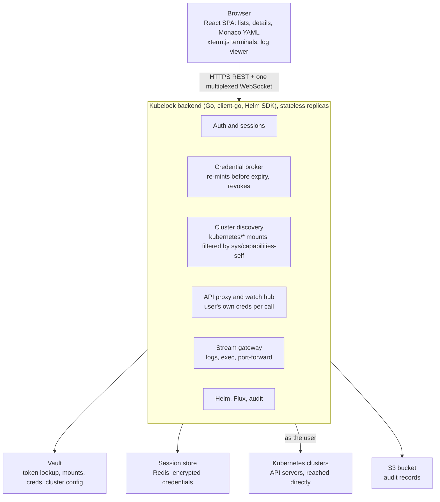

# Kubelook — Product & Technical Spec

Last updated: 2026-11-04

## Overview

Kubelook is a browser-based Kubernetes console. Users sign in with a Vault token or an uploaded kubeconfig and get full day-2 operations on every cluster that credential reaches, with no desktop install.

**Problem.** Engineers need to investigate and operate many Kubernetes clusters, and cluster access is brokered through Vault. They need one place in the browser where a Vault token, or a kubeconfig, opens exactly the clusters they are allowed to see. No credentials should be stored on their own machines.

**Goals**

- Two sign-in paths: a Vault token, or a kubeconfig file.
- A Vault token loads every cluster the token's policies can get credentials for. A kubeconfig loads every context in the file.
- Day-2 operations in the browser: logs, container shells, live manifest editing, Helm releases, FluxCD objects, CRDs, and status and editing for all core workload, storage and networking objects.
- Everything runs under the user's own Kubernetes identity, so cluster RBAC stays the only authority on what they can do.
- Vault stays the single place where access is defined. The console reads from Vault but never creates or changes its policies, roles or secrets engines; Vault admins keep owning those.
- No user management or authorization inside the console. Vault decides who can reach which cluster, and cluster RBAC decides what they can do there. The console has no admin role, user records or permission settings; operators configure it only through its deployment settings.

**Non-goals for v1**

- A plugin marketplace. The architecture leaves room for plugins, but v1 ships the features above as built-ins.

**Target users**

- Application engineers who need logs, shells and restarts on the namespaces they own.
- Platform and SRE engineers who manage Helm, Flux and cluster-wide objects across many clusters.
- On-call responders who need fast access from any machine without setting up a kubeconfig.

## Authentication and cluster discovery

Both sign-in paths end in the same state: a server-side session that holds short-lived Kubernetes credentials per cluster. The browser only ever gets a session cookie.

### Path A: Vault token

Each cluster has its own Kubernetes secrets engine mount at `kubernetes/<cluster-name>/`. The mount holds everything needed to build a client: `GET kubernetes/<cluster>/config` returns the API server URL (`kubernetes_host`) and CA (`kubernetes_ca_cert`), and `POST kubernetes/<cluster>/creds/<role>` mints a short-lived service account token. So there is no separate cluster registry: the mounts *are* the registry.

**Discovery (at sign-in)**

1. The user pastes a Vault token. The backend validates it with `auth/token/lookup-self` and records its TTL and policies.
2. The backend calls `GET sys/internal/ui/mounts` with the user's token and keeps the mounts of type `kubernetes` under the configured prefix (default `kubernetes/`). This needs no `sys/mounts` permission: with a token, the response includes every mount the token has path capabilities on, which covers each cluster the user can read config or mint creds for. Vault documents it as [an internal endpoint with no backwards-compatibility guarantee](https://developer.hashicorp.com/vault/api-docs/system/internal-ui-mounts), so every Vault upgrade must be tested against it before rollout.
3. For each mount, the backend checks the configured candidate roles with `POST sys/capabilities-self` on `kubernetes/<cluster>/creds/<role>` and `kubernetes/<cluster>/config` ([Vault API](https://developer.hashicorp.com/vault/api-docs/system/capabilities-self)).
4. A cluster appears in the sidebar if the token can `read` its config and `create` or `update` at least one role's creds path. If more than one role is allowed, the user picks one when opening the cluster; the first allowed role in the configured order is the default.

**Opening a cluster**

1. `GET kubernetes/<cluster>/config` gives the API server URL and CA.
2. `POST kubernetes/<cluster>/creds/<role>` with `kubernetes_namespace` and `cluster_role_binding` from the Helm values returns `service_account_name` and `service_account_token` ([Vault API](https://developer.hashicorp.com/vault/api-docs/v1.16.x/secret/kubernetes)). `cluster_role_binding=true` requires the Vault role to use `kubernetes_role_type=ClusterRole`.
3. The backend builds an in-memory client config from the URL, CA and token. Nothing is written to disk.
4. Vault's sample response for these credentials shows `renewable: false`, so the backend mints a fresh token shortly before the current one expires rather than renewing it. On logout or session expiry it revokes the lease, which removes the service account objects Vault created.

**Helm chart settings for Vault**

| Setting | Default | Purpose |
| --- | --- | --- |
| `vault.address` | none | Vault URL |
| `vault.kubernetesMountPrefix` | `kubernetes/` | Where cluster mounts live |
| `vault.credsNamespace` | `itops` | `kubernetes_namespace` sent when minting tokens, where Vault creates the temporary service account |
| `vault.clusterRoleBinding` | `true` | `cluster_role_binding` sent when minting tokens |
| `vault.candidateRoles` | none | Roles to check per cluster, in order of preference (for example `devops-role`, `platform-hub-role`) |
| `vault.tokenTTL` | unset (role default) | Optional `ttl` sent when minting tokens |

### Path B: kubeconfig upload

1. The user uploads or pastes a kubeconfig. It is parsed server-side and never written to disk.
2. Every context becomes a cluster in the sidebar, named `<file label>/<context>`.
3. Supported auth: embedded client certificates, bearer tokens, and OIDC `auth-provider` refresh tokens.
4. Rejected with a clear message: file-path references (`client-certificate`, `certificate-authority` by path), and any user entry that uses an `exec` credential plugin. The console never runs commands from a kubeconfig; `exec` plugins are not supported.
5. Server URLs pass an egress policy before any request goes out. By default it blocks link-local and cloud metadata addresses, plus any ranges listed in the deployment settings, to prevent server-side request forgery (SSRF).

### Sessions

- **Cookie:** an HttpOnly, Secure, SameSite=Lax cookie holds an opaque session ID. Mutating requests carry a CSRF token.
- **Storage:** credentials live in a session store, encrypted with a key from Vault Transit or a KMS. They are deleted when the session ends.
- **Renewal:** while the session is active, the backend silently renews the user's Vault token with `auth/token/renew-self` before it expires, and re-mints each cluster's Kubernetes token the same way. The user is told nothing while renewal works.
- **When renewal stops:** renewal fails once the token isn't renewable or reaches its maximum TTL. Only then does the console tell the user, with the time left and a box to paste a new token without closing open terminals, log streams or editors.
- **Idle sessions:** renewal stops after an idle timeout (proposed 30 min with no interaction and no open stream), so an abandoned tab doesn't keep a token alive.
- **Sources:** a user can hold a Vault session and uploaded kubeconfigs at the same time. The sidebar groups clusters by source.

## Architecture

A stateless Go backend sits between the browser and every cluster. It holds credentials, proxies API calls under the user's identity, and multiplexes watches and streams over one WebSocket per browser tab.

The browser talks only to the backend. The backend talks to Vault for identity and credentials, to the session store for encrypted state, and to each cluster's API server as the user.

- **Backend language: Go.** client-go, the Helm SDK and the Flux APIs are all Go.
- **Frontend:** React and TypeScript, Monaco for YAML, xterm.js for shells.
- **Watch hub:** one upstream watch per user, cluster, kind and namespace, fanned out to every open view. It's closed after an idle timeout and resumed from the last `resourceVersion` on reconnect.
- **One WebSocket per tab** carries watch events, log lines, exec frames and port-forward bytes as tagged channels, with a heartbeat.
- **Network placement:** the console runs inside the same network as the clusters and connects to each API server directly. There is no agent or tunnel: a cluster the console's network can't reach stays out of reach, so a private cluster stays private.
- **Deployment:** one image and a Helm chart, two or more replicas behind a load balancer with sticky WebSockets, plus a highly available Redis for sessions.

## Functional requirements

Every list and detail view is backed by a live watch, so status changes appear without a refresh. Every action is checked against the user's own RBAC before it's shown.

### Resource coverage

| Area | Kinds | Views | Actions |
| --- | --- | --- | --- |
| Workloads | Pods, Deployments, StatefulSets, DaemonSets, ReplicaSets, Jobs, CronJobs | List with status, restarts, age and readiness; detail with containers, conditions, events and owner chain | Edit, delete, scale, rollout restart, pause or resume, rollback (Deployments); trigger a Job now, suspend or resume (CronJobs); evict and delete pods |
| Configuration | ConfigMaps, Secrets, ResourceQuotas, LimitRanges, HPAs, PodDisruptionBudgets, PriorityClasses | Detail with keys; Secret values hidden until the user reveals them | Edit, delete; revealing a Secret is audited |
| Networking | Services, Endpoints, EndpointSlices, Ingresses, IngressClasses, NetworkPolicies, Gateway API (Gateways, HTTPRoutes, GRPCRoutes) when installed | Service-to-pod and Ingress-to-service links | Edit, delete, port-forward (Services and Pods) |
| Storage | PersistentVolumeClaims, PersistentVolumes, StorageClasses, VolumeSnapshots when installed | Phase, capacity, bound volume, and pods using the claim | Edit, delete, expand a PVC (when the StorageClass allows it) |
| Cluster | Nodes, Namespaces, Events, Leases, Webhook configurations | Node capacity, allocatable and pressure conditions; a filterable event stream | Cordon, uncordon, drain, add or remove taints |
| Access control | ServiceAccounts, Roles, ClusterRoles, RoleBindings, ClusterRoleBindings | A "who can" view built from bindings | Edit, delete |
| Custom resources | CustomResourceDefinitions and every served CRD | Generic list using `additionalPrinterColumns`; schema-aware detail | Edit, delete, create from a schema-driven form or raw YAML |

Metrics (CPU and memory per pod and node) come from metrics-server when it is present. A Prometheus source is optional and configured per cluster.

### Logs

- Stream with follow, pause, timestamps, tail size, "since" window and the previous container instance.
- Pick a container, or merge all containers of a pod, or all pods behind a workload or label selector, colour-coded by source.
- Client-side search with highlighting, plus a server-side filter for large streams. Download the current buffer.
- Back-pressure: the server caps each stream's rate and drops old lines in the UI buffer (proposed cap 10,000 lines).

### Shell into containers

- A browser terminal (xterm.js) over the Kubernetes `exec` subresource. It tries `/bin/bash`, then `/bin/sh`.
- Container picker, window resize, copy and paste, and reconnect after a network blip.
- Ephemeral debug container (`kubectl debug` style) for distroless images, gated by RBAC on `pods/ephemeralcontainers`.
- Optional node shell through a privileged debug pod, off by default in the deployment settings, and usable only by users whose RBAC allows creating privileged pods.
- Session start, stop, user, pod and container are always audited. **Keystroke recording** is optional and off by default (`audit.shellRecording.enabled`). When it's on, every keystroke sent to the shell is recorded with a timestamp and stored with the other audit records in the same S3 bucket, under the same retention. The terminal shows a notice that the session is recorded. Anything typed is captured, passwords included.

### Real-time manifest editing

- Monaco YAML editor with validation and autocompletion from the cluster's OpenAPI v3 schema, CRDs included.
- Before saving, a server-side dry run shows the diff against the live object and any admission errors.
- Saving uses server-side apply with field manager `kubelook`. Optimistic concurrency uses `resourceVersion`.
- While the editor is open, the object stays watched. If someone else changes it, a banner offers "reload" or "diff against mine" instead of silently overwriting.
- Create from YAML, multi-document apply, and "copy as kubectl" for every action.

### Helm

- Releases live in the cluster as storage objects prefixed `sh.helm.release.v1` ([Helm SDK](https://pkg.go.dev/helm.sh/helm/v3/pkg/storage)). The backend runs the Helm Go SDK under the user's credentials, so Helm can do only what the user's RBAC allows.
- List releases across namespaces with status, chart, app version and revision.
- Detail: user-supplied values, computed values, rendered manifest, notes, hooks and revision history.
- Actions: install from an HTTP repo or OCI registry, upgrade with edited values (shown as a diff first), rollback to a revision, uninstall, and test.
- Repositories are added per session, or set org-wide in the deployment settings.

### FluxCD

The console covers these Flux API groups and kinds ([Freelens FluxCD extension README](https://github.com/freelensapp/freelens-fluxcd-extension)).

| API group | Kinds |
| --- | --- |
| `fluxcd.controlplane.io` | FluxInstance, FluxReport, ResourceSet, ResourceSetInputProvider |
| `source.toolkit.fluxcd.io` | GitRepository, OCIRepository, HelmRepository, HelmChart, Bucket, ExternalArtifact |
| `source.extensions.fluxcd.io` | ArtifactGenerator |
| `kustomize.toolkit.fluxcd.io` | Kustomization |
| `helm.toolkit.fluxcd.io` | HelmRelease |
| `image.toolkit.fluxcd.io` | ImageRepository, ImagePolicy, ImageUpdateAutomation |
| `notification.toolkit.fluxcd.io` | Provider, Alert, Receiver |

Supported Flux: v2.2 and newer. The console reads the API versions each cluster actually serves and uses those, so a Flux 2.2 cluster and a newer one work side by side. Kinds a cluster doesn't have are hidden: the `fluxcd.controlplane.io` kinds need flux-operator, and ExternalArtifact and ArtifactGenerator need Flux 2.7 or later.

- **Dashboard:** ready, failed, suspended and in-progress counts per kind; the Flux version and controller health.
- **Detail:** conditions, last applied revision, source artifact, inventory (the objects a Kustomization or HelmRelease manages, linked to their views), history and events.
- **Reconcile:** merge-patch the annotation `reconcile.fluxcd.io/requestedAt` with the current time. It's disabled while the object is suspended.
- **Suspend and resume:** set `spec.suspend`. ArtifactGenerator uses its `source.extensions.fluxcd.io/reconcile` annotation instead.
- **Graph:** a source → Kustomization or HelmRelease → workload view, so a user can trace a failed deploy back to its Git or OCI source.

### Cross-cutting

- Global search across kinds and clusters, and a command palette.
- Namespace filter per cluster, remembered per user.
- RBAC-aware UI from `SelfSubjectAccessReview` and `SelfSubjectRulesReview`: actions the user can't perform are hidden, or disabled with the missing verb shown.
- Bulk actions on list selections: delete, restart, label.

## UI and UX

The layout is a cluster rail, a resource sidebar, a main list, and a details drawer, with a dock for terminals and logs.

- **Cluster rail (far left):** clusters grouped by source (Vault, or the name of each uploaded kubeconfig). Each shows connection status, and favourites are pinned.
- **Resource sidebar:** Overview, Workloads, Config, Network, Storage, Access Control, Helm, FluxCD, Custom Resources (grouped by API group), Events. Sections the user can't list are hidden.
- **Main list:** a sortable, filterable table with live status badges and multi-select. Column presets are saved per kind.
- **Details drawer:** opens on the right with tabs for Overview, YAML, Events, Logs and Related. Related shows owners, children, and the Flux source if any.
- **Bottom dock:** tabs for terminals, log streams and editors, which survive navigation between clusters. It docks or pops out to its own browser window.
- **Deep links:** every view has a stable URL (`/c/<cluster>/ns/<ns>/<kind>/<name>`), so links can be shared in incidents.
- **Themes and access:** light and dark themes, full keyboard navigation, and screen-reader labels on status icons.
- **Screen size:** designed for desktop browsers. Phone layouts are not supported, because terminals, YAML editing and wide resource tables need the room.
- **Cluster overview:** a page with node health, failing pods, recent warning events, and Flux and Helm failure counts.

## Security model

The backend is a credential broker, so a compromise of the backend exposes every live session. The design keeps credentials short-lived, user-scoped and never in the browser.

| Threat | Mitigation |
| --- | --- |
| Credential theft from the browser | Credentials stay server-side. The browser holds only an HttpOnly session cookie, and every page has a strict CSP. |
| Backend or session store compromise | Credentials are encrypted at rest (Vault Transit or KMS), short-lived Vault tokens (6 h TTL today), revocation on logout, and no persistence of uploaded kubeconfigs |
| Privilege escalation through the console | All Kubernetes calls use the user's own credential. The console has no cluster rights of its own. |
| SSRF through user-supplied server URLs | Egress policy on every outbound connection: block link-local and metadata addresses, and CIDR allow and deny lists from the deployment settings |
| Abuse of shells | Exec goes through the Kubernetes API, never a shell on the console host. Sessions are audited; idle shells time out (proposed 15 min). |
| Cross-site request forgery | SameSite cookies plus a CSRF token on REST calls; WebSocket upgrades check the Origin header |
| Secret exposure in the UI | Secret values are masked until revealed; each reveal is audited |

**Audit log.** We record sign-in and sign-out, every Vault credential issued (path and lease ID, never the token), every mutating Kubernetes call (verb, resource, cluster, namespace, outcome), every Helm and Flux action, every Secret reveal, and exec start and stop. Each record names the Vault identity behind the action. This is the only place the person, the cluster and the action appear together: each cluster's own audit log shows the temporary service account Vault minted, not the person.

**Audit storage.** Records are written as newline-delimited JSON to an S3 bucket, or any S3-compatible store. The console buffers records briefly and uploads them as objects under a date-based prefix. It flushes on shutdown so a clean restart loses nothing. Retention is set by whoever deploys the console: the console deletes its own objects older than the configured number of days, and `0` keeps them forever. Shipping records to an Elasticsearch endpoint is a planned future option.

| Helm setting | Default | Purpose |
| --- | --- | --- |
| `audit.s3.bucket` | none | Bucket that receives audit objects |
| `audit.s3.prefix` | `audit/` | Key prefix; objects go under `<prefix>/<yyyy>/<mm>/<dd>/` |
| `audit.s3.region` | none | Bucket region |
| `audit.s3.endpoint` | AWS default | Override for S3-compatible stores |
| `audit.s3.credentialsSecret` | none | Kubernetes Secret with access keys, if the pod has no cloud identity of its own |
| `audit.flushInterval` | `60s` (proposed) | Longest time a record waits before upload |
| `audit.retentionDays` | `0` | Days to keep audit objects; `0` keeps them forever |
| `audit.shellRecording.enabled` | `false` | Record shell keystrokes; stored under `<prefix>/sessions/<yyyy>/<mm>/<dd>/<session-id>` |

**Vault policy users need.** For each cluster they may use: `read` on `kubernetes/<cluster>/config`, and `create` or `update` on `kubernetes/<cluster>/creds/<role>`. Discovery also calls `sys/capabilities-self`, which Vault's default policy usually grants, and `sys/internal/ui/mounts`, which is unauthenticated. Vault admins should confirm both against their own policies.

## Non-functional requirements

The targets below are proposed starting points, to be confirmed after the spike.

| Area | Proposed target |
| --- | --- |
| First list render after opening a cluster | Under 2 s for 1,000 pods |
| Watch event to UI update | Under 1 s end to end |
| Concurrent users per backend replica | 200 active sessions |
| Watches per user | Shared per user, cluster and kind; idle watches closed after 60 s |
| Availability | 99.9% monthly; stateless replicas behind a load balancer, with the session store highly available |
| Clusters per Vault user | 100+ in the sidebar, with credentials fetched lazily |
| Supported Kubernetes | Kubernetes 1.35 and newer |
| Browsers | Current Chrome, Edge, Firefox and Safari |
| Observability | Prometheus metrics (sessions, watches, stream counts, Vault and API latency, error rates), OpenTelemetry traces, structured logs |
| Deployment | One container image and a Helm chart; runs in-cluster or on VMs; config via environment variables and a YAML file |

## Delivery plan

We ship in four phases, and each phase must pass a gate before the next starts. The spike comes first because the Vault discovery design is the biggest unknown.

| Phase | Scope | Gate to the next phase |
| --- | --- | --- |
| 0. Spike | Vault login and cluster discovery; pods list and logs on one cluster | Auth design holds |
| 1. Core | All core kinds with live watches; YAML edit with dry run; exec shells; kubeconfig upload | Pilot team signs off |
| 2. Platform | Helm releases; Flux dashboard, reconcile and suspend; CRD browser and forms | Security review |
| 3. Harden | Audit log to S3; metrics and tracing; load and penetration tests | — |

The phases aren't dated yet. We'll size them once the spike shows how hard the Vault and network questions are.

- **Gate 1, auth design holds:** a real user's Vault token lists exactly the clusters their policies allow, and credentials are re-minted before expiry and revoked on logout.
- **Gate 2, pilot team signs off:** one platform team uses the console for logs, shells and edits as their main tool for two weeks.
- **Gate 3, security review:** penetration test findings are fixed, and the audit trail is accepted by the security team.

## Decisions

- Vault layout: one Kubernetes secrets engine mount per cluster (`kubernetes/<cluster-name>/`); the mounts are the cluster registry.
- Sign-in: users paste a Vault token. There is no SSO integration, so the console needs no changes to Vault or Duo configuration.
- Audit: records go to an S3 bucket, with retention set in the Helm values by whoever deploys the console. Elasticsearch shipping comes later.
- Shell keystroke recording is optional, off by default, and stored with the other audit records when enabled.
- The oldest supported cluster runs Flux v2.2.2 on Kubernetes v1.35.6.

## Sources

- [Freelens repository](https://github.com/freelensapp/freelens): the extension API contracts (`docs/extensions/api.md`) and the main-process design
- [Freelens FluxCD extension](https://github.com/freelensapp/freelens-fluxcd-extension): the Flux kinds covered and the reconcile mechanism
- [Headlamp repository](https://github.com/kubernetes-sigs/headlamp): the README and the backend multiplexer and stateless kubeconfig code
- [Headlamp installation docs](https://headlamp.pages.dev/docs/latest/installation)
- [Rancher: communicating with downstream clusters](https://ranchermanager.docs.rancher.com/reference-guides/rancher-manager-architecture/communicating-with-downstream-user-clusters)
- [Rancher: authorized cluster endpoint](https://ranchermanager.docs.rancher.com/how-to-guides/new-user-guides/manage-clusters/access-clusters/authorized-cluster-endpoint)
- [Vault Kubernetes secrets engine](https://developer.hashicorp.com/vault/docs/secrets/kubernetes)
- [Vault Kubernetes secrets engine API](https://developer.hashicorp.com/vault/api-docs/v1.16.x/secret/kubernetes)
- [Vault `sys/capabilities-self`](https://developer.hashicorp.com/vault/api-docs/system/capabilities-self)
- [Vault `sys/internal/ui/mounts`](https://developer.hashicorp.com/vault/api-docs/system/internal-ui-mounts)
- [Helm storage package](https://pkg.go.dev/helm.sh/helm/v3/pkg/storage)
